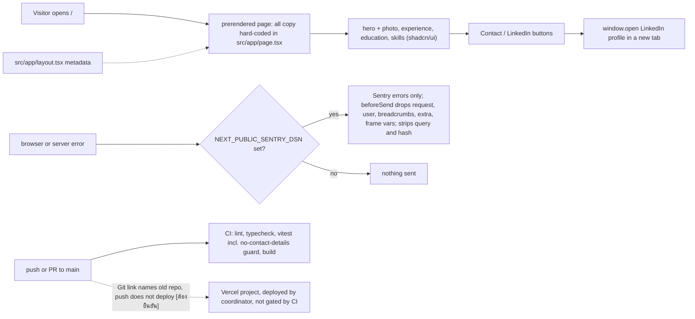
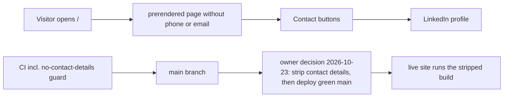

# 01 — Business process (As-Is / To-Be)

portfolio-hr-web คือหน้าเดียว (`/`) แบบ static ของ Next.js 15 ที่แสดงโปรไฟล์มืออาชีพของบุคคลที่สามหนึ่งคน (รูป ประสบการณ์ การศึกษา ทักษะ) ผู้เยี่ยมชมกดปุ่มเพื่อเปิดโปรไฟล์ LinkedIn ของบุคคลนั้น ไม่มี backend ของแอป ไม่มีฟอร์ม ไม่มีฐานข้อมูลหรือ storage ของผู้เยี่ยมชม ยกเว้นรายงาน error ไป Sentry เมื่อกำหนด `NEXT_PUBLIC_SENTRY_DSN`

Last reviewed: 2026-11-28 · commit `0acc16f`

## As-Is (จากโค้ดวันนี้)

Sources: `src/app/page.tsx`, `src/app/layout.tsx`, `src/instrumentation.ts`, `src/instrumentation-client.ts`, `src/lib/sentry.ts`, `tests/no-contact-details.test.ts`, `tests/contact-scan.ts`, `.github/workflows/ci.yml`, `PRODUCT.md`

ข้อเท็จจริงจากโค้ด:

- ไม่มี API route, ไม่มี form, ไม่มี storage; ข้อมูลทั้งหมดเป็นข้อความในไฟล์ `page.tsx`
- เบอร์โทรและอีเมลถูกถอดออกแล้ว (ตัวทดสอบ `no-contact-details` ล้มถ้ากลับมา); git history เก่ายังมีอยู่ตามการตัดสินใจของ owner ใน PRODUCT.md
- การ์ด Phone / Email ในหน้าแสดงข้อความ "Via LinkedIn message" (ไม่มีเบอร์หรืออีเมลจริง) แต่โค้ดปัจจุบันยังแสดง LINE ID ของบุคคลนั้นอยู่ 2 จุด (ส่วนติดต่อและท้ายหน้า, `src/app/page.tsx`) ตรงกับที่ PRODUCT.md บอกว่ายังมี handle ของแอปส่งข้อความบนหน้า ค่าจริงไม่คัดลอกมาที่นี่
- เว็บจริงตาม PRODUCT.md (2026-10-23) ยังเป็น build ปี 2025 ที่ยังแสดงเบอร์และอีเมล; สถานะ deploy วันนี้ [ต้องยืนยัน]

## To-Be (PRODUCT.md §Personal data และ §Live URL and deploy state)

Sources: `PRODUCT.md` §Personal data (owner decision 2026-10-23: strip, then deploy), §Live URL and deploy state

## Gap

| ID | As-Is → To-Be | Status | Owner | Evidence |
|---|---|---|---|---|
| G1 | main ไม่มีเบอร์/อีเมลแล้ว → เหมือนเดิม (strip) | done | claude | `tests/no-contact-details.test.ts`, `PRODUCT.md` §Personal data |
| G2 | เว็บจริงยังเป็น build ปี 2025 ที่แสดงเบอร์และอีเมล และ push ไป main ไม่ deploy → deploy green main (D9a) | todo | owner | `PRODUCT.md` §Live URL and deploy state [ต้องยืนยัน] |
| G3 | โค้ดยังแสดง LINE ID ของบุคคลที่สามบนหน้า (ยืนยันจาก `src/app/page.tsx`) → owner ตัดสินว่าจะคงหรือเอาออก | decide | owner | `src/app/page.tsx`, `PRODUCT.md` §Personal data |

## Open questions

- deploy ตามการตัดสินใจ 2026-10-23 เกิดขึ้นแล้วหรือยัง (ตรวจเว็บจริง)
- ต้องการให้หน้านี้แสดงข้อมูลของบุคคลที่สามต่อไปหรือไม่ เมื่อเจ้าตัวไม่ได้เป็นลูกค้าที่บันทึกไว้ใน repo
